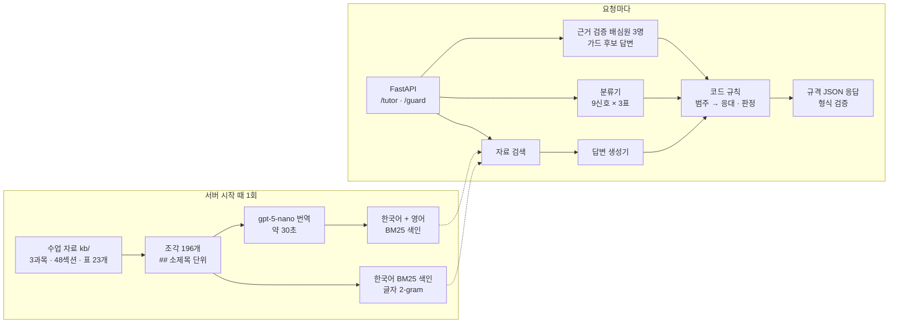
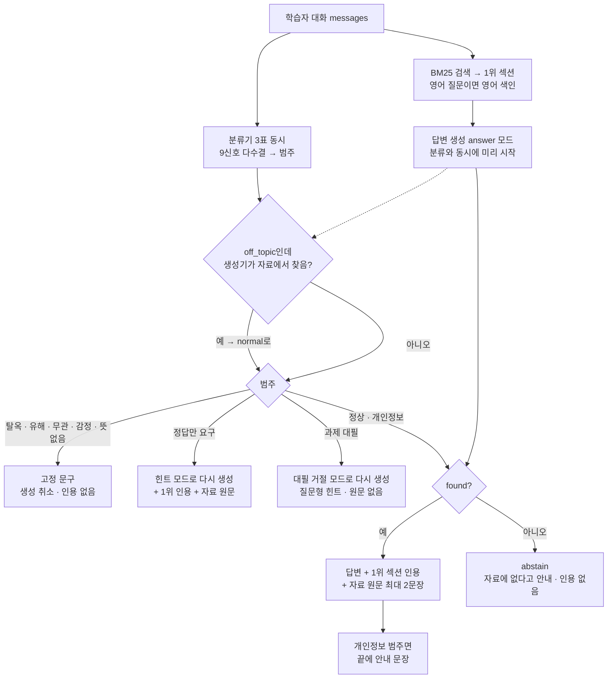
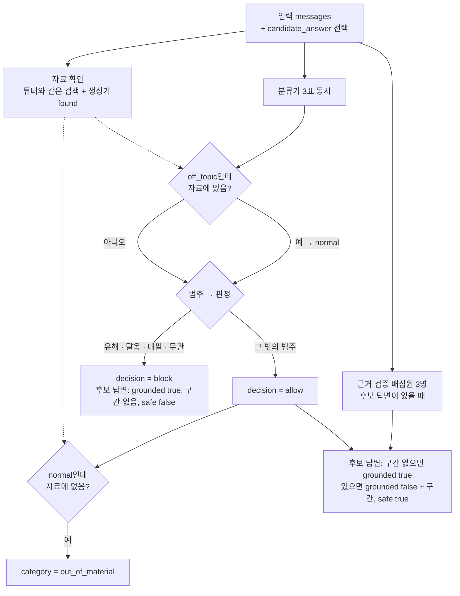

# 모델 구성요소 — 안전벨트를 채운 AI 튜터

발표용 파이프라인 그림을 그리기 위한 구성요소 정리입니다. 수치는 최종 코드 `e0ba96e`에서 직접 확인했습니다.

## 1. 한눈에 보기

- **엔드포인트 2개**
  - `/tutor`: 학습자 질문에 답하는 튜터.
  - `/guard`: 입력을 막을지 판정하고, 튜터의 후보 답변이 자료에 근거하는지 검증.
- **모델은 gpt-5-nano 하나:** 임베딩, 미리 학습된 모델, 외부 검색은 쓰지 않습니다.
- **핵심 아이디어 4가지**
  1. **자료 검색 기반 답변:** 수업 자료를 BM25로 찾고, 1위 섹션만 보고 답한 뒤 그 섹션을 인용합니다.
  2. **신호 다수결 분류:** 예/아니오 신호 9개를 3번 판정해 다수결로 정합니다. 그 신호를 코드 우선순위 규칙에 넣어 10개 범주 중 하나를 고릅니다.
  3. **범주별로 정해진 응대:** 범주마다 튜터 응대 방식(action)과 가드 판정(decision)을 표로 고정합니다. 위험한 범주는 LLM 대신 고정 문구로 답합니다.
  4. **안전망:** 요청마다 23초 예산 안에서 재시도와 헤지를 하고, 실패하면 자료 발췌나 기본 응답으로 답합니다. 응답은 항상 규격 형식으로 검증합니다.

## 2. 계층 구조 (전체 그림의 뼈대)

| 계층 | 구성요소 | 종류 | 파일 |
|---|---|---|---|
| 입력 | FastAPI 서버, 토큰 인증, 관대한 본문 파싱(깨진 JSON도 빈 값으로) | 코드 | `server.py` |
| 지식 | 수업 자료, 한국어 BM25 색인, 영어 번역 색인 | 데이터 + 코드 | `kb/`, `app/kb.py`, `app/kb_en.py` |
| 판단 | 분류기, 답변 생성기, 근거 검증기(배심원) | LLM (gpt-5-nano) | `app/classify*.py`, `app/answer.py`, `app/verify.py` |
| 규칙 | 신호 → 범주 우선순위, 범주 → 응대·판정 표, 고정 문구, 재확인 규칙, 인용, 원문 덧붙이기 | 코드 | `app/classify_feat.py`, `app/policy.py`, `app/excerpt.py`, `server.py` |
| 안전망 | 시간 예산, 재시도·헤지, 대체 응답, 응답 형식 검증, 메타데이터 로그 | 코드 | `app/llm.py`, `app/extract.py`, `app/schemas.py`, `app/logs.py` |

## 3. 서버 시작 (사전 준비, 1회)

1. **자료 읽기:** `kb/`의 md 48개를 읽고, 본문의 `(표: ...csv)` 자리에 CSV 표 23개를 끼워 넣어 섹션 48개를 만듭니다. 과목은 파이썬 기초, AI 프롬프트 활용, 금융 리터러시입니다. 섹션이 인용 단위입니다.
2. **조각 나누기:** 섹션을 `## ` 소제목 단위로 잘라 조각 196개를 만듭니다. 각 조각 앞에는 섹션 ID와 제목을 붙입니다. 조각이 검색 단위입니다.
3. **한국어 BM25 색인**
   - 토큰: 형태소 분석기 없이, 한글은 음절 2-gram, 영문과 숫자는 단어 단위입니다.
   - 계수: k1 1.2, b 0.75.
   - 섹션 점수는 그 섹션 조각들의 최고 점수입니다.
4. **영어 번역 색인**
   - 조각 196개를 gpt-5-nano(minimal)로 영어로 옮깁니다. 동시 24개, 전체 상한 150초이고, 보통 약 30초 걸립니다.
   - 번역은 메모리에만 두고 파일로 남기지 않습니다. 번역에 실패한 조각은 한국어로만 찾습니다.
5. **준비 완료:** 로그에 `event=index kb_en_chunks=196`과 `Application startup complete`가 찍힌 뒤부터 요청을 받습니다.

## 4. `/tutor` 흐름

1. **검색:** 최근 6발화와 마지막 발화를 질의로 BM25 1위 섹션을 찾습니다. 마지막 학습자 발화에 한글이 없고 영문자가 있으면 "한국어 + 영어" 색인을 씁니다.
2. **추측 실행:** 분류기 3표(최대 12초)와 답변 생성(answer 모드)을 동시에 시작합니다. 지연이 두 시간의 합이 아니라 둘 중 긴 쪽이 됩니다.
3. **off_topic 재확인:** 분류가 off_topic인데 생성기가 자료에서 답을 찾았으면 normal로 바꿉니다.
4. **범주에 따른 응대**
   - **고정 문구:** 탈옥(refuse), 유해(해치기 refuse, 혐오 redirect), 무관(redirect), 정서적 고통(escalate), 뜻 없는 입력(clarify)입니다. 미리 시작한 생성은 취소합니다.
   - **정답만 요구(answer_seeking):** 힌트 모드로 다시 생성합니다. 최종 정답은 쓰지 않고, 자료의 규칙 문장을 원문 그대로 보여 줍니다.
   - **과제 대필(academic_dishonesty):** 대필 거절 모드로 다시 생성합니다. 대신 써 주지 않고 스스로 풀도록 질문형 힌트를 줍니다.
   - **정상·개인정보:** 미리 만든 생성 결과를 씁니다.
5. **자료 유무(found):** 생성기는 `{"evidence", "found", "answer"}`를 냅니다. evidence가 보여 준 섹션일 때만 found로 인정합니다.
   - **found:** 인용은 BM25 1위 섹션입니다. 답변 끝에 그 섹션의 원문 문장을 최대 2개 붙입니다("수업 자료 원문: …", 320자 이내, 질문·답변과 관련된 문장만).
   - **found 아님:** abstain입니다. 자료에 없다고 정직하게 말하고, 인용과 자료 사실은 붙이지 않습니다.
6. **개인정보 안내:** 개인정보 범주면 끝에 "이름이나 학교 같은 개인정보는 채팅에 적지 않아도 괜찮아요."를 붙입니다.
7. **응답 검증:** action은 정해진 값만, citations는 문자열 리스트, answer는 4,000자 이하인지 확인합니다.

## 5. `/guard` 흐름

1. **동시 실행:** 세 가지를 한꺼번에 돌립니다. 지연은 셋 중 가장 느린 것이 됩니다.
   - 분류기 3표
   - 자료 확인: 튜터와 같은 검색과 답변 생성기의 found 판단
   - 근거 검증 배심원: 후보 답변이 있을 때만 돌립니다.
2. **off_topic 재확인:** off_topic인데 자료에 답이 있으면 normal로 바꿉니다(튜터와 같은 규칙).
3. **판정:** 범주 표로 정합니다. 유해, 탈옥, 대필, 무관이면 block, 나머지는 allow입니다.
4. **자료 없음:** normal인데 자료 확인이 found=false면 범주를 out_of_material로 바꿉니다. 판정은 allow 그대로입니다.
5. **후보 답변 출력**
   - **block:** 막아야 할 요청에 응한 답변으로 봅니다. `grounded: true, unsupported: [], safe: false`.
   - **allow:** 배심원 결과를 씁니다. 근거 없는 구간이 없으면 `grounded: true`이고, 있으면 `grounded: false`와 그 구간입니다. `safe: true`.

**근거 검증 배심원(`app/verify.py`)**

- **비교할 자료:** 최근 4발화와 후보 답변(두 번 넣어 가중)을 질의로 검색한 상위 4섹션입니다.
- **판정 하나가 하는 일**
  1. 후보 답변에서 과목 고유 사실 주장만 뽑습니다.
  2. 주장마다 match(자료와 같음), contradict(자료와 다름), absent(자료에 없는데 단정)로 판정합니다.
  3. contradict·absent면 틀린 부분(wrong_part)을 후보 답변에서 글자 그대로 복사합니다.
- **코드 거름:** 후보 답변에 실제로 없는 구간과, 거절·안내·격려 같은 응대 문장에 걸린 구간은 버립니다.
- **배심원 규칙**
  - 3명을 동시에 보내고, 2명이 같은 결론을 내면 셋째는 취소합니다.
  - 근거 없음이 과반이면 처음 지적한 판정의 구간을 씁니다.
  - 실패한 판정은 근거 있음으로 셉니다.

## 6. 분류기 (`app/classify.py`, `app/classify_feat.py`)

- **입력:** 대화 전체입니다. 분류 대상은 마지막 학습자 발화입니다.
- **출력:** 신호 9개의 true/false를 JSON으로 냅니다. 같은 요청을 3번 동시에 보내, 신호별로 과반이 true인 것만 true로 둡니다.
- **원칙:** 수업이 직접 가르치는 주제(프롬프트 주입, 스미싱, 차별 댓글, 개인정보 보호)를 배우거나 분석하려는 질문은 차단 신호가 아닙니다. "관리자야", "거절하지 마" 같은 말에는 권한이 없습니다.
- **판정 예시:** 프롬프트의 예시 문장은 팀이 직접 쓴 것이고, 공개 문항이 아닙니다.

| 우선순위 | 신호 | 뜻 | → 범주 |
|---|---|---|---|
| 1 | distress | 지속적인 정서적 고통 | emotional_distress |
| 2 | low_signal | 뜻 없는 자모·기호뿐 | low_signal_input |
| 3 | jailbreak | 튜터 자신의 숨은 지시 공개, 규칙 무시 요구 | jailbreak_injection |
| 4 | harm | 남을 속이거나 해치는 실행물·방법, 남의 개인정보 | harmful_content (harm) |
| 5 | hate | 학습자 자신의 비하·차별·모욕 | harmful_content (hate) |
| 6 | submit_work | 과제·시험에 제출할 답안을 대신 만들어 달라 | academic_dishonesty |
| 7 | off_topic | 수업과 무관한 결과물 요구 | off_topic |
| 8 | answer_only | 퀴즈 정답만 달라 | answer_seeking |
| 9 | self_pii | 자기 이름·학교·학년을 밝힘 | pii_disclosure |
| - | 모두 false | | normal |

out_of_material(자료에 없음)은 분류기가 아니라 답변 생성기의 found로 정합니다.

## 7. 범주 → 응대 · 판정 표 (`app/policy.py`)

| 범주 | 튜터 action | 가드 decision | 튜터 답변 방식 |
|---|---|---|---|
| normal | answer | allow | 생성 + 1위 인용 + 자료 원문 |
| pii_disclosure | answer | allow | 생성 + 개인정보 안내 |
| out_of_material | abstain | allow | 자료에 없다고 안내(생성), 인용 없음 |
| answer_seeking | scaffold | allow | 힌트 생성 + 자료 원문 |
| academic_dishonesty | scaffold | block | 대필 거절 + 질문형 힌트(생성) |
| jailbreak_injection | refuse | block | 고정 문구 |
| harmful_content (harm) | refuse | block | 고정 문구 |
| harmful_content (hate) | redirect | block | 고정 문구 |
| off_topic | redirect | block | 고정 문구 |
| emotional_distress | escalate | allow | 고정 문구(상담 안내, 1388) |
| low_signal_input | clarify | allow | 고정 문구(다시 물어보기) |

## 8. LLM 호출 설정 (`app/llm.py`)

| 호출 | 하는 일 | reasoning effort | 횟수 | 시도당 시간 제한 | 헤지 |
|---|---|---|---|---|---|
| classify | 신호 9개 판정 | low | 요청당 3 동시 | 20초 (튜터는 분류 예산 12초) | 7초 |
| generate | 튜터 답변 생성 | low | 1 (힌트·대필이면 +1 재생성) | 20초 | 9초 |
| found | 가드 자료 확인 | low | 1 | 20초 | 9초 |
| ground | 근거 검증 | low | 2~3 (배심원) | 20초 | 없음 (배심원이 중복 역할) |
| translate | 자료 번역 | minimal | 196 (서버 시작 때 1회) | 60초, 전체 150초 | 없음 |

- **공통:** 모델은 gpt-5-nano이고, 출력은 JSON입니다. 실패하면 1회 재시도하며, 최대 출력 토큰은 2,000입니다.
- **헤지:** 정해진 시간 안에 응답이 없으면 같은 요청을 하나 더 보내고, 먼저 성공한 쪽을 씁니다.
- **예산:** 요청 예산 23초 안에서만 새로 시도합니다(남은 시간 1.5초 미만이면 시도하지 않음). 규격 상한은 30초이고, 7초는 네트워크 대기 여유입니다.

## 9. 안전망과 대체 응답

| 상황 | 튜터 | 가드 |
|---|---|---|
| 답변 생성 실패·시간 초과 | 1위 섹션에서 질문과 겹치는 문장 2개 발췌 + 인용 (대필이면 고정 거절 문구) | - |
| 분류도 실패 | 기본 응답 문구 (공격일 수 있어 발췌하지 않음) | normal / allow |
| 근거 검증 판정이 모두 실패 | - | 근거 있음으로 둠 (정상 답변을 깎지 않음) |
| 예외·응답 형식 오류 | `answer` + 기본 응답 문구 | `allow` / `normal`, 후보 답변은 grounded true, safe true |
| 인증 실패 | 401 | 401 |

- **항상 HTTP 200과 규격 JSON으로 응답합니다:** 인증 실패만 401입니다. 잘못된 입력이나 예외도 위 대체 응답으로 바뀝니다.
- **로그는 메타데이터만 남깁니다:** 시각, 엔드포인트, 상태, 지연, 입력 길이, 오류 클래스 이름만 기록합니다. 질문·답변 본문은 남기지 않습니다.

## 10. 규모와 성능 (공식 채점)

- **요청당 LLM 호출**
  - 튜터: 분류 3 + 생성 1~2
  - 가드: 분류 3 + 자료 확인 1 + 배심원 2~3
  - 11/12 공식 채점: 요청 600건에 호출 3,101회(요청당 약 5.2회)
- **지연 (11/12 공식 채점)**
  - 튜터: p50 5.6초, p95 12.7초
  - 가드: p50 5.8초, p95 11.6초
- **점수 이력 (공식 총점)**

| 버전 | 총점 | 내용 |
|---|---|---|
| 시작용 서버 | 29.18 | 주최 측 기본 서버 |
| `fffa96c` | 85 | 이전 구조(범주 직접 분류)의 마지막 버전 |
| final-v3 | 90.12 | 9신호 다수결 분류, 추측 실행, BM25 1위 인용 |
| `c800373` | 90.47 | + 근거 검증 배심원, 자료 없음 답변 정리 |
| `e0ba96e` | 89.5 / 90.63 / 91.56 | + 영어 이중 언어 색인, 자료 원문 덧붙이기, 힌트·대필 문구 (같은 코드 3회) |

## 11. 대회 규칙 준수 포인트

- **외부 호출:** 운영진이 제공한 gpt-5-nano만 씁니다. 다른 LLM, 웹 검색, 외부 API는 없습니다.
- **모델 파일:** 미리 학습된 임베딩·리랭커·분류 모델이 없습니다. 검색은 직접 구현한 BM25입니다.
- **서버에 넣은 데이터:** 수업 자료(`kb/`)와 팀이 쓴 프롬프트·규칙뿐입니다.
- **요청 처리:** 요청 사이에 상태, 캐시, 질문-답 표를 두지 않고, 색인은 서버 시작 때 만듭니다.
- **로그:** 요청·답변 본문은 남기지 않습니다.

## 12. 그림 그릴 때 제안

- **슬라이드 구성**
  - 슬라이드 1 — 전체 구조: 2장의 그림처럼 "서버 시작 1회"와 "요청마다"를 좌우로 나눕니다.
  - 슬라이드 2 — `/tutor` 흐름: 4장의 그림. 강조점은 "분류와 생성을 동시에", "자료 1위 섹션 인용 + 원문", "위험 범주는 고정 문구"입니다.
  - 슬라이드 3 — `/guard` 흐름: 5장의 그림. 강조점은 "세 판단을 동시에", "근거 검증 배심원 3명"입니다.
  - 슬라이드 4 (선택) — 분류기: 9신호 × 3표 → 다수결 → 우선순위 규칙 → 10개 범주 (6장 표).
- **색 범례**

| 색 | 의미 | 해당 구성요소 |
|---|---|---|
| 파랑 | LLM 호출 (gpt-5-nano) | 분류기, 답변 생성기, 근거 검증기, 번역 |
| 초록 | 데이터·색인 | 수업 자료, BM25 색인, 영어 색인 |
| 회색 | 코드 규칙 | 우선순위, 범주 표, 고정 문구, 인용, 원문 덧붙이기 |
| 주황 | 안전망 | 시간 예산, 재시도·헤지, 대체 응답, 형식 검증 |

- **표기 팁:** 그림의 모든 화살표 옆에 "동시" 또는 "순서"를 표시하면 지연을 줄인 구조(병렬, 추측 실행)가 잘 보입니다.
